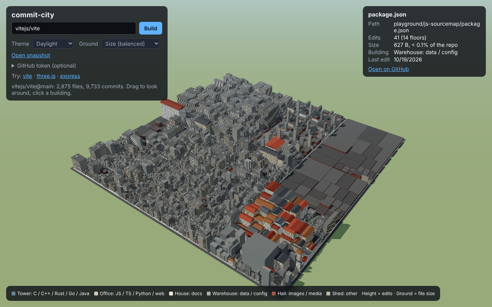
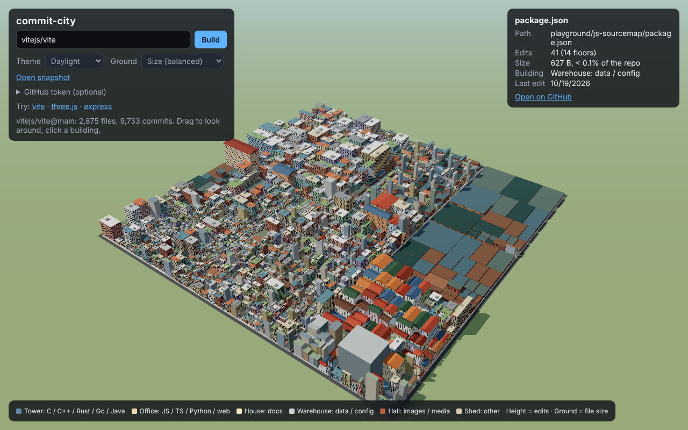
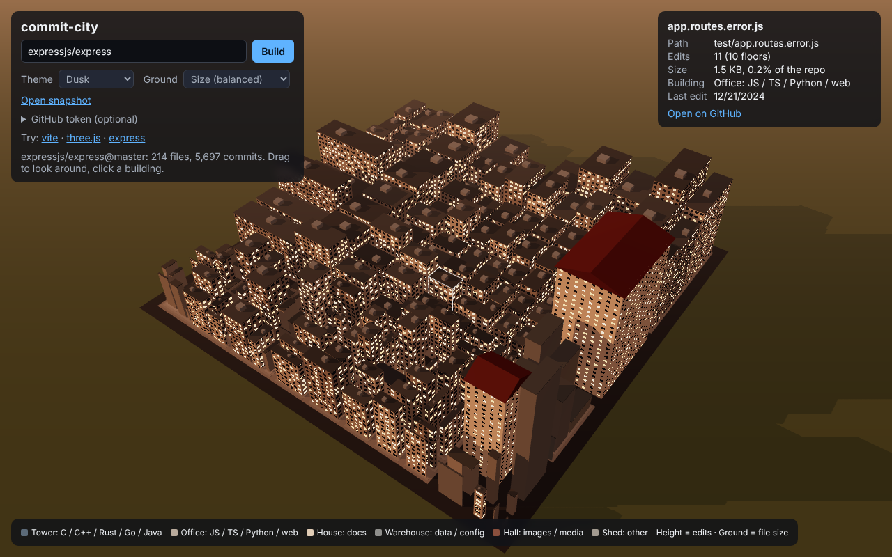

[English](README.md) | 日本語

# commit-city

**GitHubのリポジトリを3Dの街にして、その歴史を再生する。**

リポジトリを入れると、コードがブラウザの中で街になります。フォルダは区画、ファイルはビルで、何度も編集されたファイルほど高いビルに、大きいファイルほど広い敷地になります。街を見て回り、ビルをクリックすると、そのファイルをGitHubで開けます。



| vitejs/vite | 夕暮れの express |
|---|---|
|  |  |

> 状態：v0.1。今のリポジトリの姿を街にします。コミット履歴の再生は次の版で入れます（ロードマップ参照）。

## 街の読み方

| 街 | リポジトリ |
|---|---|
| 区画（一段高い台） | フォルダ。深いフォルダほど高い位置にあり、奥に行くほど道が細くなる |
| ビル | ファイル |
| 高さ | そのファイルを編集したコミットの数（対数：1回で3階、10回で9階、100回で17階、1000回で25階） |
| 敷地の広さ | リポジトリ全体に対するファイルサイズの割合。既定の **Balanced** は平方根を使い、大きな画像やロックファイル数個で街の半分が空き地にならないようにする。**Exact share** はそのままの割合 |
| 建物の種類 | ファイルの種類（下の表） |
| 色 | 実際の街のような塗装。テーマの色見本から、ビルごとに壁と屋根の色を選ぶので、色分けの図ではなく本物の街っぽく見える |

| 建物 | ファイル |
|---|---|
| ガラスのタワー | C、C++、Rust、Go、Swift、C#、Java、Kotlin、Scala |
| オフィスビル | JavaScript、TypeScript、Python、HTML/CSS、Ruby、PHP、シェル |
| 三角屋根の家 | ドキュメント：Markdown、テキスト |
| 倉庫 | データと設定：JSON、YAML、TOML、ロックファイル、SQL |
| レンガのホール | 画像、フォント、音声、動画 |
| 小屋 | その他 |

編集回数はファイル名の変更を追いかけるので、移動したファイルも履歴を引き継ぎます。区画の配置には squarified treemap を使い、窓はシェーダーで描き（テクスチャなし）、建物の種類ごとに1つのインスタンスメッシュで描くので、数万ファイルのリポジトリでも滑らかに動きます。

## 使い方

**[keito118.github.io/commit-city](https://keito118.github.io/commit-city/)** を開くと、まずサンプルの街が出ます。サンプル（有名なオープンソースの [vite](https://github.com/vitejs/vite) と [express](https://github.com/expressjs/express)）は前もってスキャンしてあるので、全履歴が反映されていて、GitHubのAPIを1回も使いません。

ほかのリポジトリを街にするときは、入力欄に `owner/repo`（GitHubのURLでも可）を入れるか、URLに付けます。

```
https://keito118.github.io/commit-city/?repo=vitejs/vite
https://keito118.github.io/commit-city/?repo=expressjs/express&theme=dusk
https://keito118.github.io/commit-city/?example=express
```

URLも一緒に変わるので、見ている街をそのまま共有できます。

- ドラッグで回転、右ドラッグで移動、スクロールでズーム
- ビルをクリックすると、編集回数、サイズ、リポジトリ内の割合、最後の編集日と、ファイルへのリンクが出る
- **Theme** で見た目を選べる

### 編集回数の集め方

GitHubのAPIでは、どのファイルが変わったかはコミットを1つずつ聞かないと分からないので、高さにはコミット1つにつき1回のリクエストがかかります。

| 方法 | 読む履歴 | メモ |
|---|---|---|
| トークンなし | 直近25コミット | トークンなしは見ている人ごとに1時間60回まで。街2つ分くらい |
| GitHubトークン（**GitHub token** 欄） | 直近400コミット | 1時間5000回まで使え、自分のPrivateリポジトリも開ける。読み取り専用の **Contents** 権限だけの fine-grained token で十分 |
| `npm run scan` | 全履歴 | 手元のクローンを読むので、APIを使わない。大きいリポジトリやPrivateリポジトリにおすすめ |

スキャナーの使い方：

```bash
npm run scan -- path/to/your/repo > my-repo.city.json
```

できたファイルを **Open snapshot** で開く（ページにドロップしてもよい）。Node.js 22.18 以上が必要です。

### リクエスト、上限、トークンについて

- サーバーはありません。見ている人のブラウザが直接GitHubに聞きに行くので、上限は見ている人ごとに数えられ、誰かがたくさん使っても他の人の分は減りません。
- トークン欄に入れたトークンは、入れた本人のものです。その人のブラウザ（`localStorage`）にだけ保存され、送り先は `api.github.com` だけです。サイト自体はトークンを持っていませんし、持たせるべきではありません。公開ページの中身は誰でも読めるからです。
- コミットを読んでいる途中で上限に達しても、そこまで読めた分で街を描き、いつ上限が解除されるかを表示します。
- APIで作った街はそのタブに30分間保存されるので、ページを再読み込みしてもリクエストを使いません。

## テーマ

見た目は配置とは切り離した「着せ替え」です。今は **Daylight**（昼）、**Dusk**（夕暮れ）、**Cyberpunk** の3つがあります。テーマは [`src/themes.ts`](src/themes.ts) の1項目で、空、芝生、道路と歩道、建物の種類ごとの壁と屋根の色、窓の色、明かりのついた窓の割合、光の当たり方を決めます。日本の町並みや西洋の旧市街も追加予定です。

## 手元で動かす

```bash
npm install
npm run dev     # http://localhost:5173/?repo=vitejs/vite
npm test
npm run build   # dist/ に静的サイトを出力
npm run scan -- ../some-repo > some-repo.city.json
```

サンプルは `public/examples/` にあります。新しくするときは、最新のクローンをスキャンして上書きします（例：`npm run scan -- ../vite > public/examples/vite.city.json`）。

TypeScript、[Three.js](https://threejs.org/)、[d3-hierarchy](https://github.com/d3/d3-hierarchy)（treemap）、Vite で作っています。サーバーはなく、すべてブラウザで動きます。

## 作った理由と、難しかったところ

コードベースの形をひと目で見たかった。どこが賑やかで、どこがずっと変わらないのか、どのフォルダが街の中心なのか。CodeCity や Gource のような可視化はあるけれど、インストールや手元のクローンが要る。commit-city は URL だけでブラウザで動く。

- **GitHub はコミットで変わったファイルを、そのコミットを聞かないと教えてくれない。** なので高さにはコミット1件ごとに API リクエストがかかり、トークンなしは1時間60回まで。ここから、履歴スキャナー、前もってスキャンしたサンプル、上限のヘッダーを読んで失敗せずに途中までの街を描く仕組みが生まれた。
- **ファイルサイズだけでは物差しにならない。** vite では数枚の画像がサイズの半分を占め、そのままの割合だと街の半分が空き地になった。既定の広さは平方根を使い、順番は保ったまま極端な差を和らげている。
- **数万のビルを滑らかに動かす必要がある。** 建物の種類ごとに1つのインスタンスメッシュで描き、窓はテクスチャではなく、ビルの実際の大きさからフラグメントシェーダーで描いている。

## ロードマップ

できたこと（v0.1）：今のリポジトリの姿を、本物っぽい建物の街にする。テーマ3種、全履歴を読むスキャナー、サンプルの街。

これから（順番は未定）：

- **街のクオリティを上げる**
  - 薄っぺらい建物や、現実にない建物は避ける
  - 街の象徴になるもの：公園、エッフェル塔のようなタワー、学校など、本物の街にある建物
- **街に動きを**：人や車がランダムに動く
- **サンプルを増やす**：トークンなしで見られる街
- **町のタイプを選ぶ**：いくつかの町並み（日本の町並み、西洋の旧市街など）から選べる
- **歴史の再生**：スライダーで、コミットごとに街が育つ様子を見る
- **その先**：直すべき場所（よく変わる大きいファイル）の表示、有名OSSの街のギャラリー、動画やGIFの書き出し、解説記事

## ライセンス

[MIT](LICENSE)
